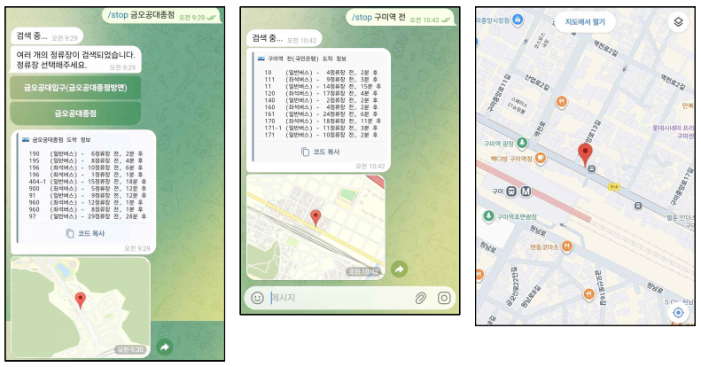
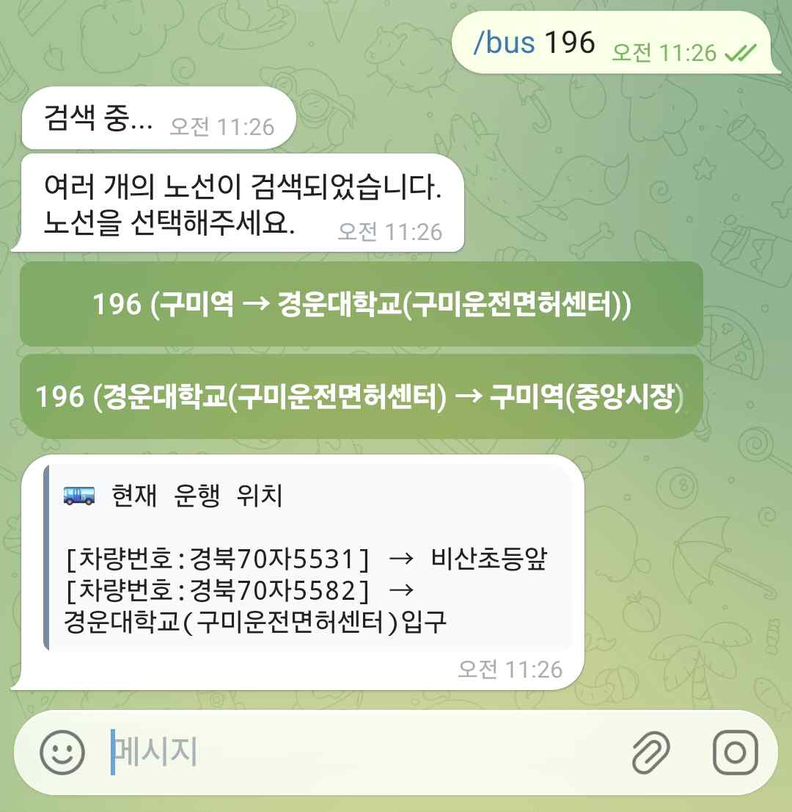
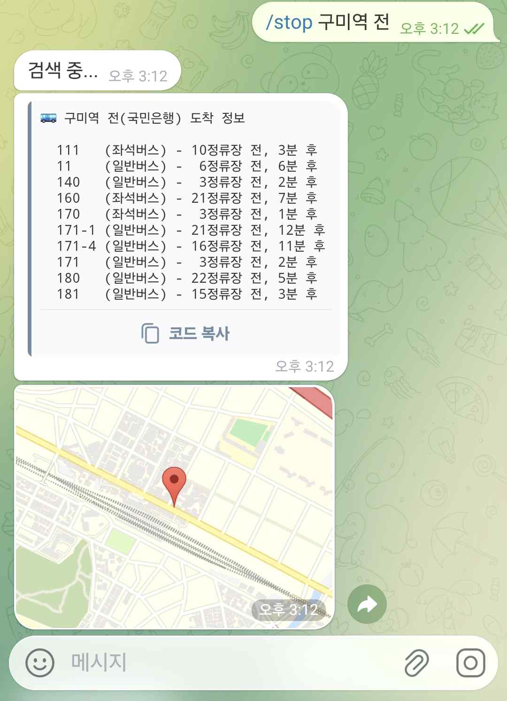
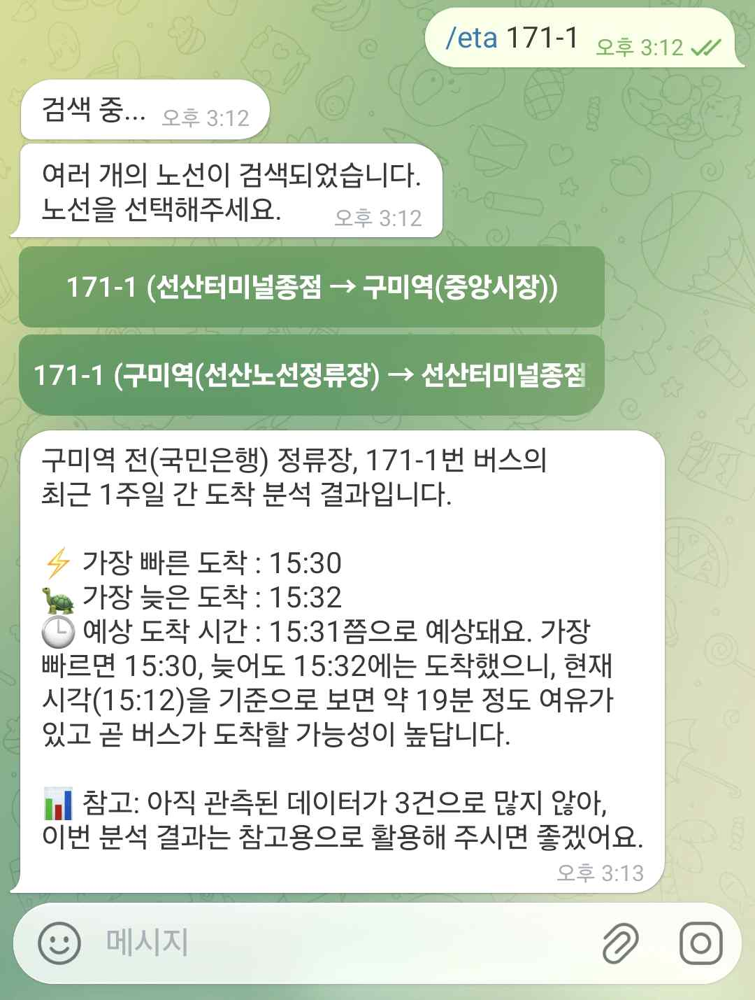
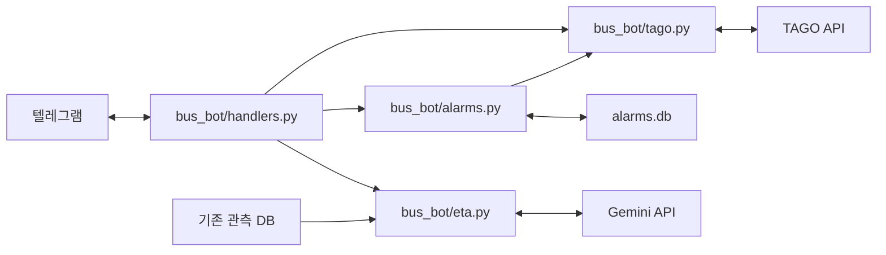

# 구미 버스 도착 알림 텔레그램 봇

2025년 고급파이썬프로그래밍 개인 프로젝트입니다. 국토교통부 TAGO의 정류소·도착·노선·차량 위치 API를 연동해 구미 시내버스 정보를 텔레그램에서 조회하고, 선택한 정류장과 노선에 대해 도착 전 알림을 받을 수 있도록 구현했습니다.

## 주요 기능

| 명령 | 동작 |
| --- | --- |
| `/stop 금오공대종점` | 정류장을 검색하고 도착 예정 버스 목록과 정류장 위치를 표시합니다. |
| `/gps` | 텔레그램에서 공유한 위치로 주변 정류장을 검색합니다. |
| `/bus 196`, `/route 196` | 운행 중인 차량의 위치 또는 노선의 경유 정류장과 운행 위치를 표시합니다. |
| `/alarm 금오공대종점` | 정류장과 노선을 선택해 알림을 등록합니다. 30초마다 도착 정보를 조회하고 남은 시간이 20·10·5분 기준을 통과할 때 알립니다. 등록한 알림은 30분 뒤 만료됩니다. |
| `/unalarm` | 현재 채팅의 알림을 해제합니다. |
| `/eta 196` | 먼저 정류장을 선택한 뒤 노선을 고르면 최근 7일간 비슷한 시간대의 관측을 바탕으로 참고용 도착 시간을 안내합니다. |

## 텔레그램 사용 화면

아래는 과제 당시 촬영한 실행 화면입니다.

### 정류장 검색과 도착 정보

`/stop`으로 정류장을 검색하면 도착 예정 목록과 정류장 위치를 볼 수 있습니다.



### 운행 중인 차량 위치

`/bus 196`에서 노선 방향을 선택하면 차량별 위치를 정류장 이름으로 확인할 수 있습니다.



### 도착 전 알림

57번 버스의 도착 10분 전과 5분 전 알림이 휴대전화에 표시된 화면입니다.


### 과거 관측 기반 도착 안내

`/stop 구미역 전`으로 정류장을 선택한 뒤 `/eta 171-1`로 노선을 골라 참고용 도착 시각을 확인합니다.




## 구현 구조



- `Bus_Alert.py`는 설정을 읽어 봇을 실행합니다. `bus_bot/`에는 명령·버튼 처리, TAGO 조회, 알림 저장·발송, ETA 안내가 각각의 모듈에 있습니다.
- 알림은 채팅당 하나씩 저장합니다. 같은 정류장의 도착 정보를 채팅 간에 공유하며, 한 번 등록한 알림에서는 각 기준 시각의 알림을 한 번씩 보냅니다.
- 과제 기간인 2025년 11월 28일~12월 4일에 도착 임박 관측 **5,882건**을 저장했습니다. 각 행의 시각은 TAGO 응답을 수집한 시각입니다.
- ETA는 정류장·노선·평일/주말·요청 시각 이후 20분을 기준으로 과거 관측을 추립니다. Gemini에 시각 목록의 요약과 해석을 요청하고, 호출에 실패하면 Python에서 계산한 중앙값과 최솟값·최댓값을 표시합니다.

## 실행

Python 3.13 환경에서 아래 명령을 실행합니다.

```powershell
python -m pip install -r requirements.txt
```

저장소 폴더에 `API.env`를 직접 만들고 아래 항목에 본인의 키를 입력합니다. Gemini를 사용하는 경우 `GEMINI_API_KEY`도 입력합니다.

```dotenv
TELEGRAM_BOT_TOKEN_NEW=
bus_stop=
bus_arrival=
bus_route=
bus_loc=
GEMINI_API_KEY=
```

저장소 폴더에서 봇을 실행한 뒤 텔레그램에서 `/start`를 입력합니다.

```powershell
python Bus_Alert.py
```

알림 설정을 저장하는 `alarms.db`는 봇이 실행될 때 생성됩니다. `/eta`를 사용하려면 최근 관측이 들어 있는 기존 `bus_arrivals.db`를 실행 폴더에 두세요.

## 과제 버전의 한계

- 개발 당시 TAGO 도착정보는 약 90~120초 간격으로 갱신되는 것으로 관찰됐습니다. 알림 시점은 이 데이터의 갱신 주기에 영향을 받습니다.
- API 호출 한도에 맞춰 수집 대상을 4개 정류장으로 줄였습니다. ETA 오차는 실제 도착 시각과 비교해 측정하지 않았습니다.
- 알림 설정은 SQLite에 남습니다. 봇을 재시작하면 남은 시간 추적과 기준별 발송 기록은 다시 시작합니다.
